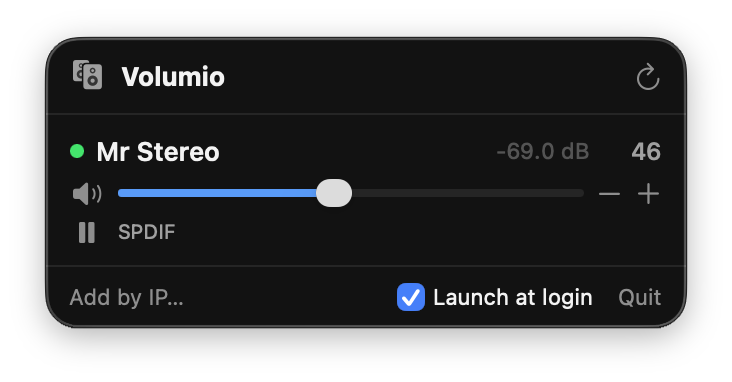

# VolumioBar

A macOS menu bar app that finds every Volumio player on your network (miniDSP SHD / SHD Studio, Raspberry Pi builds, etc.) and stacks a volume slider for each one.



- Automatic discovery over Bonjour (`_Volumio._tcp`, the same thing Volumio's own apps use)
- Per player: slider, mute, ± one Volumio volume step, play/pause, and what's playing
- Shows dB next to the level when the player reports it (`dbVolume`)
- Add players by IP when discovery can't see them (other subnet/VLAN)
- Launch at login checkbox

There's also an iPhone/iPad home screen widget made with Scriptable in [`scriptable/`](scriptable/README.md).

## Requirements

- macOS 14 Sonoma or newer
- Xcode 16 or newer

## Build and run

1. Open `VolumioBar.xcodeproj`.
2. Press **⌘R**. A speaker icon appears in the menu bar (there's no Dock icon).
3. When macOS asks whether VolumioBar may find devices on your local network, click **Allow**.

The project is set to **Sign to Run Locally**, so you don't need an Apple developer account. If you have one, you can pick your team under *Signing & Capabilities* instead.

### Install it in Applications

From Terminal, in this folder:

```sh
xcodebuild -project VolumioBar.xcodeproj -scheme VolumioBar -configuration Release -derivedDataPath build
cp -R build/Build/Products/Release/VolumioBar.app /Applications/
open /Applications/VolumioBar.app
```

Then tick **Launch at login** in the panel.

## Using it

- Drag a slider to set that player's volume. The request goes out while you drag.
- Speaker button: mute/unmute. **−/+**: one volume step, using the step size set in Volumio.
- Right-click a player to open its Volumio web UI, or to remove a player you added by IP.
- The panel refreshes every 1.5 s while it's open and every 30 s while it's closed.

## Troubleshooting

**Nothing shows up**

- Check *System Settings › Privacy & Security › Local Network* and make sure VolumioBar is on.
- Bonjour doesn't reach across subnets or VLANs. If your Mac and the SHD are on different networks, use **Add by IP…**.
- Test the API directly: `curl http://<player-ip>:3000/api/v1/getState` should return JSON with a `volume` field.

**The slider moves but the sound doesn't change**

Some Volumio updates on the SHD have broken volume control from Volumio's own UI too. Check whether the slider in the Volumio web UI works. If it doesn't, the problem is in the device firmware, not in this app.

## How it talks to Volumio

| What | Request |
|---|---|
| Discovery | Bonjour `_Volumio._tcp`, port 3000; TXT record has `volumioName` and `UUID` |
| State | `GET /api/v1/getState` gives `volume`, `mute`, `dbVolume`, `status`, `title`, `artist`, `disableVolumeControl` |
| Set volume | `GET /api/v1/commands/?cmd=volume&volume=<0-100\|plus\|minus\|mute\|unmute>` |
| Play/pause | `GET /api/v1/commands/?cmd=toggle` |
| Name/UUID (manual add) | `GET /api/v1/getSystemInfo` |

## Files

- `VolumioBarApp.swift`: app entry, the `MenuBarExtra`
- `BonjourBrowser.swift`: finds players and resolves them to an IPv4 address
- `DeviceStore.swift`: the player list, manually added players, polling
- `VolumioDevice.swift`: one player's state, plus sending volume while you drag
- `VolumioAPI.swift`: REST client
- `ContentView.swift`, `DeviceRow.swift`: the panel UI
- `Config/Info.plist`: menu bar only (`LSUIElement`), local network permission, plain HTTP on the LAN
